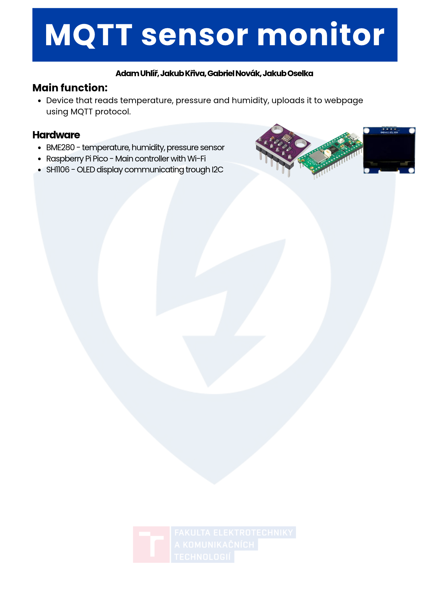
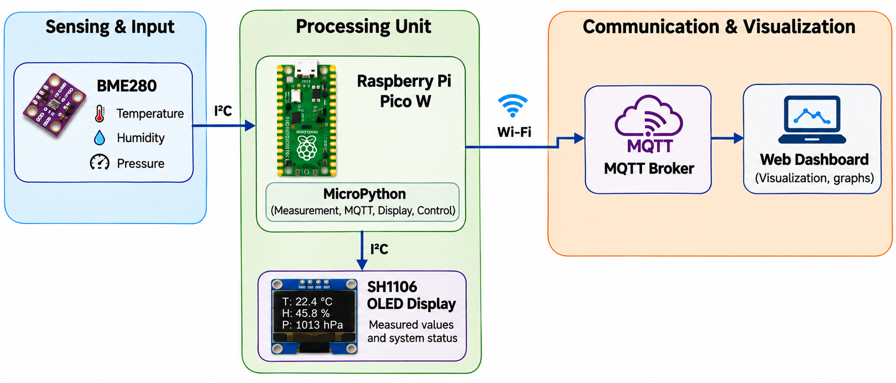
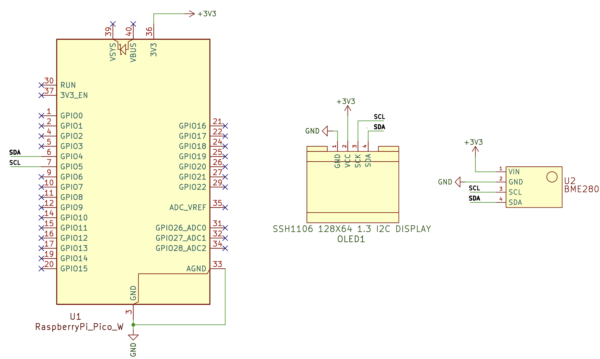
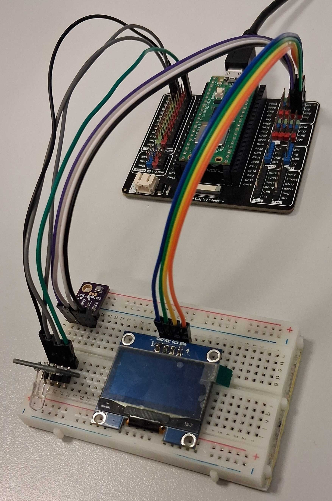
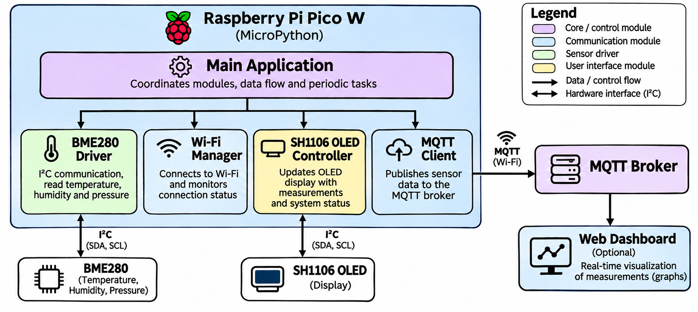

# DE2-projekt-MQTT-sensor-monitor
> MQTT Sensor Monitor using Raspberry Pi Pico W and MicroPython.

An IoT environmental monitoring system that measures temperature, humidity, and atmospheric pressure using a BME280 sensor. The measured data is transmitted via Wi-Fi to an MQTT broker and can be visualized on a web dashboard.

## Poster
*Coming soon*



## Video Demonstration
*Coming soon*

## Table of Contents
- [Poster](#poster)
- [Video Demonstration](#video-demonstration)
- [Overview](#overview)
- [Team](#team)
- [How It Works](#how-it-works)
- [Hardware](#hardware)
  - [Hardware Components](#hardware-components)
  - [Hardware Connections](#hardware-connections)
  - [Top-Level Block Diagram](#top-level-block-diagram)
  - [Wiring Diagram](#wiring-diagram)
  - [Electrical Schematic](#electrical-schematic)
  - [Physical Hardware Setup](#physical-hardware-setup)
- [Software](#software)
  - [Software Architecture](#software-architecture)
  - [Software Block Diagram](#software-block-diagram)
  - [Timing and Concurrency](#timing-and-concurrency)
- [Project Structure](#project-structure)
- [License](#license)

## Overview
The MQTT Sensor Monitor is an IoT project designed to monitor environmental conditions using a Raspberry Pi Pico W and MicroPython.

The system measures temperature, humidity, and atmospheric pressure using a BME280 sensor. The collected data will be transmitted over Wi-Fi to an MQTT broker. As an optional extension, the measurements may also be visualized through a web dashboard.

The project demonstrates:

- Environmental monitoring using a BME280 sensor
- I2C communication between the sensor and Raspberry Pi Pico W
- Wireless communication via Wi-Fi
- MQTT protocol for transmitting sensor data
- Local indication of connection status
- Real-time data visualization using graphs
- Modular programming in MicroPython

## Team

This project is developed by a team of four students as part of the BPC-DE2 (Digital Electronics 2) course at VUT FEKT in 2026.

| Team Member | Responsibilities |
|-------------|------------------|
| Jakub Křiva | Main Programming Designer |
| Adam Uhlíř | Repository Management & Documentation |
| Gabriel Novák | Scheme & Testbenches |
| Jakub Oselka | Presentation & Debugging |

## How It Works

The MQTT Sensor Monitor collects environmental data using a BME280 sensor connected to a Raspberry Pi Pico W. The measured values are transmitted over Wi-Fi to an MQTT broker and can be displayed on a web dashboard.

| Step | Action | Description |
|------|--------|-------------|
| 1 | System Startup | Raspberry Pi Pico W initializes the sensor and other components. |
| 2 | Wi-Fi Connection | The device connects to the configured Wi-Fi network. |
| 3 | MQTT Connection | The device establishes a connection with the MQTT broker. |
| 4 | Sensor Measurement | The BME280 measures temperature, humidity, and atmospheric pressure. |
| 5 | Data Transmission | Sensor readings are published to MQTT topics at regular intervals. |
| 6 | Local Status Indication | LEDs or a display indicate the current connection status. |
| 7 | Data Visualization | A web dashboard may display current measurements and graphs. |

As an optional extension, the system may detect connection failures and automatically reconnect when the network or MQTT broker becomes unavailable.

## Hardware

The MQTT Sensor Monitor is based on the Raspberry Pi Pico W microcontroller. It uses a BME280 sensor to measure environmental conditions and Wi-Fi connectivity to transmit data to an MQTT broker.

### Hardware Components

| Component | Description | Interface |
|-----------|-------------|-----------|
| Raspberry Pi Pico W | Main microcontroller running MicroPython | GPIO, I2C, Wi-Fi |
| BME280 Sensor | Measures temperature, humidity, and atmospheric pressure | I2C |
| SH1106 OLED Display | Displays sensor measurements and connection status | I2C |
| Wi-Fi Access Point | Provides wireless network connectivity | Wi-Fi |
| Computer | Hosts the MQTT broker and optional web dashboard | Wi-Fi / Ethernet |

### Hardware Connections

The BME280 sensor and SH1106 OLED display will be connected to the Raspberry Pi Pico W using a shared I2C bus.

The proposed pin assignments are shown below:

| Raspberry Pi Pico W | BME280 | SH1106 OLED | Function |
|---------------------|--------|-------------|----------|
| GP4 (Pin 6) | SDA | SDA (Pin 4) | I2C Data |
| GP5 (Pin 7) | SCL | SCK (Pin 3) | I2C Clock |
| 3V3(OUT) (Pin 36) | VIN (Pin 1) | VCC (Pin 2) | 3.3 V Power Supply |
| GND (Pin 3) | GND (Pin 2) | GND (Pin 1) | Ground |

The detailed connections will be illustrated in the wiring diagram and electrical schematic below.

*The proposed pin assignments will be verified during hardware implementation.*

### Top-Level Block Diagram



### Wiring Diagram

The following diagram illustrates the connections between the Raspberry Pi Pico W, BME280 sensor, and SH1106 OLED display.


### Electrical Schematic

The following schematic shows the detailed electrical connections and pin assignments of the Raspberry Pi Pico W, BME280 sensor, and SH1106 OLED display.



### Physical Hardware Setup

The following image shows the actual hardware setup of the MQTT Sensor Monitor, including the Raspberry Pi Pico W, BME280 sensor, and SH1106 OLED display.



## Software

The software is developed in MicroPython and is designed to handle sensor measurements, Wi-Fi connectivity, MQTT communication, and OLED display control.

### Software Architecture

The software will be divided into separate modules to simplify development, testing, and maintenance.

| Module | Description |
|--------|-------------|
| BME280 Driver | Handles I2C communication and reads environmental measurements. |
| Wi-Fi Manager | Manages Wi-Fi connectivity and connection status. |
| MQTT Client | Publishes sensor data to the MQTT broker. |
| SH1106 OLED Controller | Handles OLED display updates and connection status indication. |
| Main Application | Coordinates sensor measurements, communication, and system operation. |
| Web Dashboard | Displays received measurements and graphs |

### Software Block Diagram

The following diagram illustrates the main software modules and their interactions within the MQTT Sensor Monitor.



### Timing and Concurrency

The system will perform several periodic tasks, including sensor measurements, MQTT data transmission, and OLED display updates.

The proposed timing plan is shown below:

| Task | Proposed Interval | Description |
|------|-------------------|-------------|
| Sensor Measurement | 2 s | Read temperature, humidity, and pressure from the BME280 sensor. |
| MQTT Publishing | 5 s | Publish the latest measurements to the MQTT broker. |
| OLED Display Update | 1 s | Update the displayed measurements and connection status. |
| Connection Monitoring | 5 s | Check Wi-Fi and MQTT connection status. |

The application will be designed to coordinate these tasks without unnecessary blocking.

MicroPython's `uasyncio` may be used to manage concurrent tasks, allowing sensor measurements, MQTT communication, and display updates to operate independently.

The proposed intervals and concurrency approach will be verified and adjusted during software implementation.

## Project Structure

The current repository structure is as follows:

```text
DE2-projekt-MQTT-sensor-monitor/
│
├── complete-projects/           # Complete project ZIP archives
│
├── images/                      # Project images and diagrams
│   ├── poster.png               # Project poster
│   ├── block_diagram.png        # Top-level block diagram
│   ├── wiring_diagram.png       # Hardware wiring diagram
│   ├── electrical_schematic.png # Electrical schematic from KiCad
│   └── physical_setup.jpg       # Actual hardware setup
│
├── software/                    # Software and source code (to be added)
│
├── README.md                    # Main project documentation
├── LICENSE                      # MIT License
└── .gitignore                   # Git ignore rules
```
*The repository structure will be expanded during project development.*

## License
This project is licensed under the MIT License. See the [LICENSE](LICENSE) file for more details.


