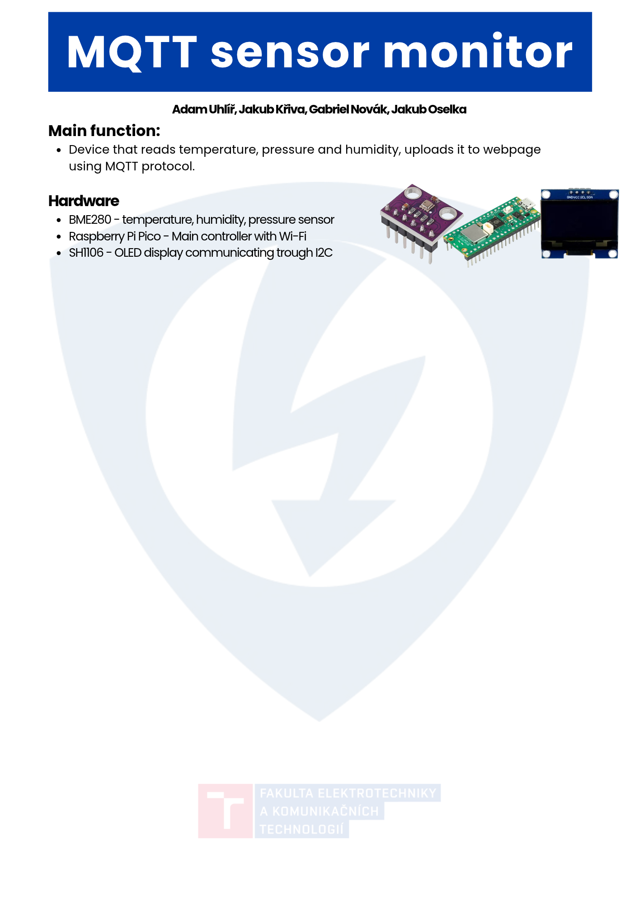
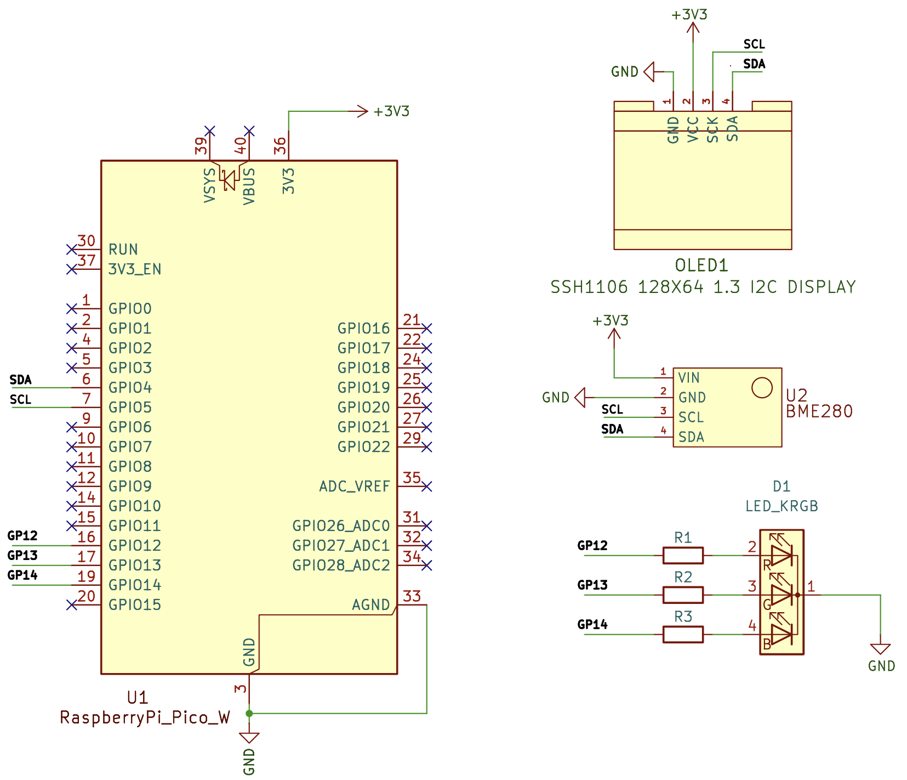
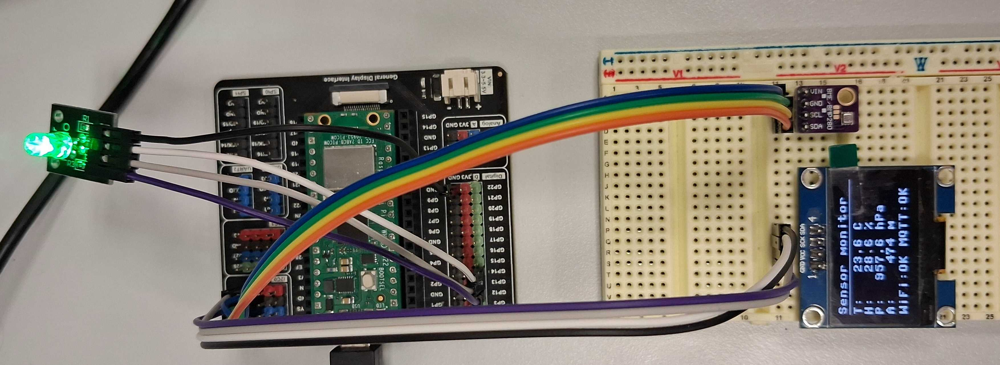

# DE2-projekt-MQTT-sensor-monitor
> MQTT Sensor Monitor using Raspberry Pi Pico W and MicroPython.

An IoT environmental monitoring system that measures temperature, humidity, and atmospheric pressure using a BME280 sensor. The measured data is transmitted via Wi-Fi to an Eclipse Mosquitto MQTT broker and visualized on a web dashboard. An SH1106 OLED display shows the measured values, while an RGB LED indicates the connection status.


## Poster




## Video Demonstration
*Coming soon*


## Table of Contents
- [Poster](#poster)
- [Video Demonstration](#video-demonstration)
- [Overview](#overview)
- [Team](#team)
- [How It Works](#how-it-works)
- [Hardware](#hardware)
  - [Hardware Components](#hardware-components)
  - [Hardware Connections](#hardware-connections)
  - [Top-Level Block Diagram](#top-level-block-diagram)
  - [Electrical Schematic](#electrical-schematic)
  - [Physical Hardware Setup](#physical-hardware-setup)
- [Software](#software)
  - [Software Architecture](#software-architecture)
  - [Software Dependencies](#software-dependencies)
  - [Module Interfaces (API)](#module-interfaces-api)
  - [Software Block Diagram](#software-block-diagram)
  - [Timing and Concurrency](#timing-and-concurrency)
  - [Component Tests](#component-tests)
- [Project Structure](#project-structure)
- [License](#license)


## Overview
The MQTT Sensor Monitor is an IoT project designed to monitor environmental conditions using a Raspberry Pi Pico W and MicroPython.

The system measures temperature, humidity, and atmospheric pressure using a BME280 sensor. The collected data is transmitted over Wi-Fi to an Eclipse Mosquitto MQTT broker. The measurements are also visualized through a web dashboard.

The project demonstrates:

- Environmental monitoring using a BME280 sensor
- I2C communication between the sensor and Raspberry Pi Pico W
- Wireless communication via Wi-Fi
- MQTT protocol for transmitting sensor data
- Local visualization of sensor measurements and connection status using an SH1106 OLED display
- Real-time data visualization using graphs
- Modular programming in MicroPython
- RGB LED indication of Wi-Fi and MQTT connection status


## Team

This project is developed by a team of four students as part of the BPC-DE2 (Digital Electronics 2) course at VUT FEKT in 2026.

| Team Member | Responsibilities |
|-------------|------------------|
| Jakub Křiva | Main Programming Designer |
| Adam Uhlíř | Repository Management & Documentation |
| Gabriel Novák | Scheme & Testbenches |
| Jakub Oselka | Presentation & Debugging |


## How It Works

The MQTT Sensor Monitor collects environmental data using a BME280 sensor connected to a Raspberry Pi Pico W. The measured values are transmitted over Wi-Fi to an Eclipse Mosquitto MQTT broker and displayed on a web dashboard.

| Step | Action | Description |
|------|--------|-------------|
| 1 | System Startup | Raspberry Pi Pico W initializes the sensor and other components. |
| 2 | Wi-Fi Connection | The device connects to the configured Wi-Fi network. |
| 3 | MQTT Connection | The device establishes a connection with the MQTT broker. |
| 4 | Sensor Measurement | The BME280 measures temperature, humidity, and atmospheric pressure. |
| 5 | Data Transmission | Sensor readings are published to MQTT topics at regular intervals. |
| 6 | Local Status Indication | The SH1106 OLED display shows sensor measurements and Wi-Fi/MQTT connection status. |
| 7 | RGB LED Status Indication | The RGB LED indicates connection status: green when connected, red when disconnected, and blinking yellow while connecting. |
| 8 | Data Visualization | A web dashboard displays current measurements and graphs. |

The system detects connection failures and automatically reconnects when the Wi-Fi network or MQTT broker becomes unavailable.


## Hardware

The MQTT Sensor Monitor is based on the Raspberry Pi Pico W microcontroller. It uses a BME280 sensor to measure environmental conditions and Wi-Fi connectivity to transmit data to an Eclipse Mosquitto MQTT broker. An SH1106 OLED display provides local visualization of measurements, while an RGB LED indicates the Wi-Fi and MQTT connection status.


### Hardware Components (BOM)

| Component | Specification | Quantity | Description | Interface | Datasheet |
|---|---|---:|---|---|---|
| Raspberry Pi Pico W | RP2040 | 1 | Main microcontroller running MicroPython | GPIO, I2C, ADC, Wi-Fi | [View Datasheet](datasheets/raspberry_pi_pico_w.pdf) |
| BME280 Sensor | BME280 | 1 | Measures temperature, humidity, and atmospheric pressure | I2C | [View Datasheet](datasheets/bme280.pdf) |
| SH1106 OLED Display | 128 × 64 pixels | 1 | Displays sensor measurements, connection status, and lunar phases | I2C | [View Datasheet](datasheets/sh1106.pdf) |
| RGB LED Module | Common cathode | 1 | Indicates Wi-Fi and MQTT connection status using different colors | GPIO | — |
| MQ-9 Gas Sensor | MQ-9 | 1 | Detects carbon monoxide and combustible gases | ADC | — |
| Push Button | Momentary push button | 1 | Switches between OLED display modes | GPIO | — |
| Breadboard | Solderless | 1 | Provides hardware prototyping connections | — | — |
| Jumper Wires | Connecting wires | 17 | Connect individual hardware components | — | — |
| Wi-Fi Access Point | Wireless network | 1 | Provides wireless network connectivity | Wi-Fi | — |
| Computer | MQTT server | 1 | Hosts the Eclipse Mosquitto MQTT broker and web dashboard | Wi-Fi / Ethernet | — |


### Hardware Connections

The BME280 sensor and SH1106 OLED display are connected to the Raspberry Pi Pico W using a shared I2C bus.

The pin assignments are shown below:

| Raspberry Pi Pico W | BME280 | SH1106 OLED | Function |
|---------------------|--------|-------------|----------|
| GP4 (Pin 6) | SDA | SDA (Pin 4) | I2C Data |
| GP5 (Pin 7) | SCL | SCK (Pin 3) | I2C Clock |
| 3V3(OUT) (Pin 36) | VIN (Pin 1) | VCC (Pin 2) | 3.3 V Power Supply |
| GND | GND (Pin 2) | GND (Pin 1) | Ground |

The RGB LED module is connected to three GPIO pins and indicates the Wi-Fi and MQTT connection status. The module includes built-in current-limiting resistors.

| Raspberry Pi Pico W | RGB LED | Function |
|---------------------|---------|----------|
| GP12 (Pin 16) | R (Red) | Red color control |
| GP13 (Pin 17) | G (Green) | Green color control |
| GP14 (Pin 19) | B (Blue) | Blue color control |
| GND | Common Cathode | Ground |

The RGB LED indicates the connection status as follows:

- Green: Wi-Fi and MQTT connections are established.
- Red: Wi-Fi or MQTT connection is unavailable.
- Blinking yellow: The system is attempting to establish or restore a connection.

The detailed connections are illustrated in the electrical schematic below.


### Top-Level Block Diagram


### Electrical Schematic

The following schematic shows the detailed electrical connections and pin assignments of the Raspberry Pi Pico W, BME280 sensor, SH1106 OLED display, and RGB LED module.




### Physical Hardware Setup

The following image shows the actual hardware setup of the MQTT Sensor Monitor, including the Raspberry Pi Pico W, BME280 sensor, SH1106 OLED display, and RGB LED.




## Software

The software is developed in MicroPython and handles sensor measurements, Wi-Fi connectivity, MQTT communication, OLED display control, and RGB LED status indication.

The Raspberry Pi Pico W runs MicroPython version 3.15.2.


### Software Architecture

The software is divided into separate modules to simplify development, testing, and maintenance.

| Module | Description |
|--------|-------------|
| BME280 Driver | Handles I2C communication and reads environmental measurements. |
| Wi-Fi Manager | Manages Wi-Fi connectivity and connection status. |
| MQTT Client | Publishes sensor data to the Eclipse Mosquitto MQTT broker. |
| SH1106 OLED Controller | Handles OLED display updates and connection status indication. |
| Main Application | Coordinates sensor measurements, communication, and system operation. |
| RGB LED Controller | Controls RGB LED colors and blinking patterns based on Wi-Fi and MQTT connection status. |
| Web Dashboard | Displays received measurements and real-time graphs. |


### Software Dependencies

The MQTT Sensor Monitor is developed in MicroPython for the Raspberry Pi Pico W. The application uses built-in MicroPython modules and additional libraries for sensor communication, display control, Wi-Fi connectivity, and MQTT communication.

| Library / Module | Description |
|---|---|
| `machine` | Provides access to GPIO pins and the I2C interface. |
| `asyncio` | Manages concurrent tasks for sensor measurements, display updates, Wi-Fi, and MQTT communication. |
| `network` | Provides Wi-Fi connectivity through the Raspberry Pi Pico W wireless interface. |
| `rp2` | Provides Raspberry Pi RP2-specific functionality. |
| `json` | Encodes sensor measurements into JSON messages for MQTT transmission. |
| `umqtt.simple` | Implements the MQTT client used to communicate with the Eclipse Mosquitto broker. |
| [`bme280.py`](software/bme280.py) | Driver for reading temperature, humidity, and atmospheric pressure from the BME280 sensor. |
| [`sh1106.py`](software/sh1106.py) | Driver for controlling the SH1106 OLED display over I2C. |
| [`wifi_utils.py`](software/wifi_utils.py) | Provides helper functions for establishing and managing Wi-Fi connections. |

The application also uses `config.py` for Wi-Fi credentials and MQTT broker configuration. An example configuration is available in [`config_example.py`](software/config_example.py).


### Module Interfaces (API)

The software uses separate modules for sensor measurements, OLED display control, and Wi-Fi connectivity. Each module provides functions that can be reused by the main application and individual component tests.

| Module | Main Functions / Methods | Description |
|---|---|---|
| [`bme280.py`](software/bme280.py) | `BME280(i2c)`, `temperature()`, `humidity()`, `pressure()` | Initializes the BME280 sensor and reads environmental measurements. |
| [`bme280.py`](software/bme280.py) | `read_values()` | Returns temperature, humidity, pressure, and estimated altitude as a tuple. |
| [`sh1106.py`](software/sh1106.py) | `SH1106_I2C(i2c)`, `text()`, `fill()`, `pixel()` | Initializes the OLED display and draws text or graphics in the display buffer. |
| [`sh1106.py`](software/sh1106.py) | `show()`, `contrast()`, `poweron()`, `poweroff()` | Updates the display, adjusts brightness, and controls its power state. |
| [`wifi_utils.py`](software/wifi_utils.py) | `connect()`, `connect_async()` | Establishes a Wi-Fi connection using synchronous or asynchronous operation. |
| [`wifi_utils.py`](software/wifi_utils.py) | `disconnect()`, `print_status()` | Disconnects the Wi-Fi interface and displays connection status information. |
| [`main.py`](software/main.py) | Main Application | Coordinates sensor measurements, OLED display updates, Wi-Fi connectivity, and MQTT communication. Detailed documentation is available in the [Software README](software/README.md). |

The BME280 sensor and SH1106 OLED display communicate through the shared I2C interface using GPIO 4 (SDA) and GPIO 5 (SCL).

The RGB LED is controlled directly through GPIO 12, GPIO 13, and GPIO 14 using the MicroPython `machine.Pin` interface.

Individual hardware modules can be verified using the standalone test programs described in the [Component Tests Documentation](software/tests/README.md).


### Software Block Diagram

The following diagram illustrates the main software modules and their interactions within the MQTT Sensor Monitor.


### Timing and Concurrency

The system performs several periodic tasks, including sensor measurements, MQTT data transmission, OLED display updates, connection monitoring, and RGB LED status indication.

The task intervals are shown below:

| Task | Interval | Description |
|------|----------|-------------|
| Sensor Measurement | 60 s | Read temperature, humidity, and pressure from the BME280 sensor. |
| MQTT Publishing | 60 s | Publish the latest measurements to the MQTT broker. |
| OLED Display Update | 1 s | Update the displayed measurements and connection status. |
| Connection Monitoring | 5 s | Check Wi-Fi and MQTT connection status. |
| RGB LED Update | 0.5 s | Update LED color and blinking state according to connection status. |

The application coordinates these tasks without unnecessary blocking.

MicroPython's `uasyncio` manages concurrent tasks, allowing sensor measurements, MQTT communication, display updates, and RGB LED status indication to operate concurrently.


### Component Tests

Individual hardware components were tested on the Raspberry Pi Pico W before integration into the main application.

The tests verify the functionality of the BME280 sensor, SH1106 OLED display, and RGB LED module.

| Component | Test | Result |
|---|---|---|
| BME280 Sensor | [BME280 Test](software/tests/bme280_test.py) | PASS |
| SH1106 OLED Display | [SH1106 Test](software/tests/sh1106_test.py) | PASS |
| RGB LED | [RGB LED Test](software/tests/rgb_test.py) | PASS |

Detailed descriptions, testing procedures, and expected results are available in the [Component Tests Documentation](software/tests/README.md).


## Project Structure

The repository is organized as follows:

```text
DE2-projekt-MQTT-sensor-monitor/
├── datasheets/
│   ├── raspberry_pi_pico_w.pdf
│   ├── bme280.pdf
│   └── sh1106.pdf
│
├── images/
│   ├── Electrical_Scheme_DE2.png
│   ├── block_diagram.png
│   ├── physical_setup.jpg
│   ├── poster.png
│   └── software_block_diagram.png
│
├── software/
│   ├── tests/
│   │   ├── README.md
│   │   ├── bme280_test.py
│   │   ├── rgb_test.py
│   │   └── sh1106_test.py
│   ├── README.md 
│   ├── bme280.py
│   ├── config_example.py
│   ├── main.py
│   ├── sh1106.py
│   └── wifi_utils.py
│
├── .gitignore
├── LICENSE
└── README.md
```

## License
This project is licensed under the MIT License. See the [LICENSE](LICENSE) file for more details.


