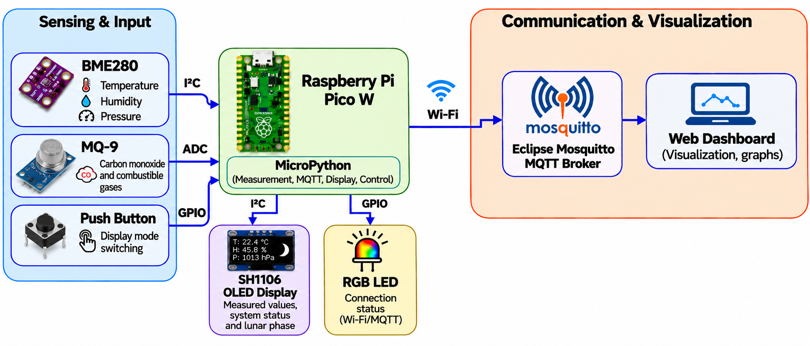
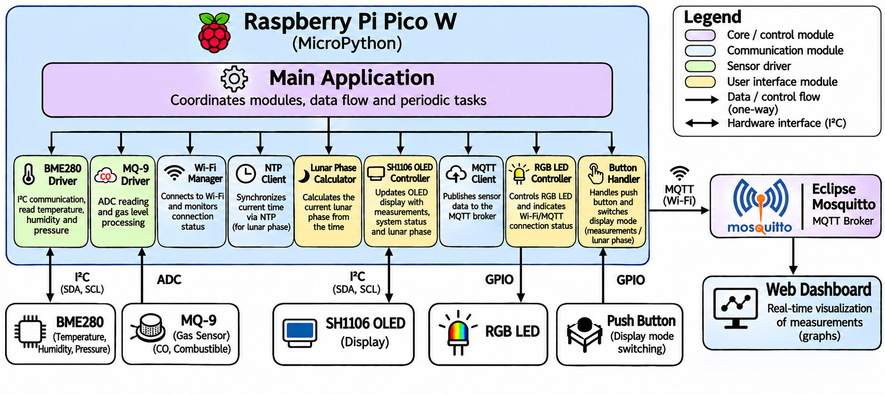
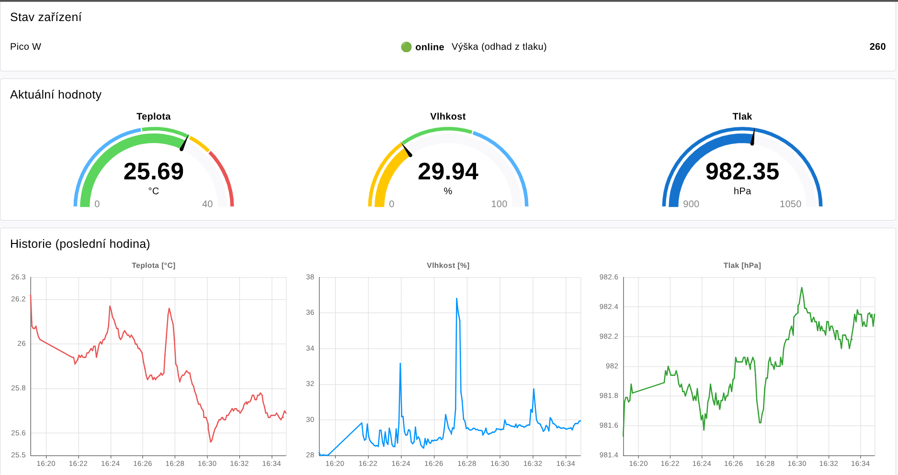

# DE2-projekt-MQTT-sensor-monitor
> MQTT Sensor Monitor using Raspberry Pi Pico W and MicroPython.

An IoT environmental monitoring system that measures temperature, humidity, and atmospheric pressure using a BME280 sensor. The measured data is transmitted via Wi-Fi to an Eclipse Mosquitto MQTT broker and visualized on a web dashboard. An SH1106 OLED display shows the measured values, while an RGB LED indicates the connection status.


## Poster


## Video Demonstration
*Coming soon*


## Table of Contents
- [Poster](#poster)
- [Video Demonstration](#video-demonstration)
- [Overview](#overview)
- [Team](#team)
- [How It Works](#how-it-works)
- [Hardware](#hardware)
  - [Hardware Components (BOM)](#hardware-components-bom)
  - [Hardware Connections](#hardware-connections)
  - [Top-Level Block Diagram](#top-level-block-diagram)
  - [Electrical Schematic](#electrical-schematic)
  - [Physical Hardware Setup](#physical-hardware-setup)
- [Software](#software)
  - [Software Architecture](#software-architecture)
  - [Software Dependencies](#software-dependencies)
  - [Module Interfaces (API)](#module-interfaces-api)
  - [Software Block Diagram](#software-block-diagram)
  - [Timing and Concurrency](#timing-and-concurrency)
  - [Component Tests](#component-tests)
  - [Web Dashboard](#web-dashboard)

- [Project Structure](#project-structure)
- [License](#license)


## Overview

The MQTT Sensor Monitor is an IoT project designed to monitor environmental conditions using a Raspberry Pi Pico W and MicroPython.

The system measures temperature, humidity, and atmospheric pressure using a BME280 sensor and monitors the analog output of an MQ-9 gas sensor. The collected data is transmitted over Wi-Fi to an Eclipse Mosquitto MQTT broker and visualized through a web dashboard.

The SH1106 OLED display provides two display modes: environmental measurements and lunar phases. A push button allows the user to switch between these modes. The current lunar phase is calculated using time synchronized via NTP.

The project demonstrates:

- Environmental monitoring using a BME280 sensor
- Gas detection using an MQ-9 sensor
- I2C communication between hardware components
- Analog signal acquisition using ADC
- GPIO-based input and output control
- Wireless communication via Wi-Fi
- MQTT protocol for transmitting sensor data
- Local visualization using an SH1106 OLED display
- Display mode switching using a push button
- Time synchronization using NTP
- Lunar phase calculation and visualization
- Real-time data visualization using graphs
- Modular programming in MicroPython
- RGB LED indication of Wi-Fi and MQTT connection status


## Team

This project is developed by a team of four students as part of the BPC-DE2 (Digital Electronics 2) course at VUT FEKT in 2026.

| Team Member | Responsibilities |
|-------------|------------------|
| Jakub Křiva | Main Programming Designer |
| Adam Uhlíř | Repository Management & Documentation |
| Gabriel Novák | Scheme & Testbenches |
| Jakub Oselka | Presentation & Debugging |


## How It Works

The MQTT Sensor Monitor collects environmental data using BME280 and MQ-9 sensors connected to a Raspberry Pi Pico W. The measured values are transmitted over Wi-Fi to an Eclipse Mosquitto MQTT broker and displayed on a web dashboard.

| Step | Action | Description |
|------|--------|-------------|
| 1 | System Startup | Raspberry Pi Pico W initializes the sensors, OLED display, RGB LED, push button, and Wi-Fi interface. |
| 2 | Wi-Fi Connection | The device connects to the configured Wi-Fi network. |
| 3 | Time Synchronization | The device synchronizes its internal clock using NTP. |
| 4 | MQTT Connection | The device establishes a connection with the MQTT broker. |
| 5 | Sensor Measurement | The BME280 measures temperature, humidity, and atmospheric pressure. The MQ-9 provides an analog voltage related to gas presence. |
| 6 | Data Transmission | Sensor readings are published to MQTT topics at regular intervals. |
| 7 | Local Visualization | The SH1106 OLED display shows sensor measurements and Wi-Fi/MQTT connection status. |
| 8 | Display Mode Switching | The push button switches between the sensor measurement screen and the lunar phase screen. |
| 9 | Lunar Phase Calculation | The current lunar phase is calculated using the synchronized time and visualized on the OLED display. |
| 10 | RGB LED Status Indication | The RGB LED indicates connection status: green when connected, red when disconnected, and blinking yellow while connecting. |
| 11 | Data Visualization | A web dashboard displays current measurements and graphs. |

The system detects connection failures and automatically reconnects when the Wi-Fi network or MQTT broker becomes unavailable.


## Hardware

The MQTT Sensor Monitor is based on the Raspberry Pi Pico W microcontroller. It uses a BME280 sensor to measure environmental conditions and Wi-Fi connectivity to transmit data to an Eclipse Mosquitto MQTT broker. An SH1106 OLED display provides local visualization of measurements, while an RGB LED indicates the Wi-Fi and MQTT connection status.


### Hardware Components (BOM)

| Component | Specification | Quantity | Description | Interface | Datasheet |
|---|---|---:|---|---|---|
| Raspberry Pi Pico W | RP2040 | 1 | Main microcontroller running MicroPython | GPIO, I2C, ADC, Wi-Fi | [View Datasheet](datasheets/raspberry_pi_pico_w.pdf) |
| BME280 Sensor | BME280 | 1 | Measures temperature, humidity, and atmospheric pressure | I2C | [View Datasheet](datasheets/bme280.pdf) |
| SH1106 OLED Display | 128 × 64 pixels | 1 | Displays sensor measurements, connection status, and lunar phases | I2C | [View Datasheet](datasheets/sh1106.pdf) |
| RGB LED Module | Common cathode | 1 | Indicates Wi-Fi and MQTT connection status using different colors | GPIO | — |
| MQ-9 Gas Sensor | MQ-9 | 1 | Detects carbon monoxide and combustible gases | ADC | [View Datasheet](datasheets/mq9.pdf) |
| Push Button | Momentary push button | 1 | Switches between OLED display modes | GPIO | — |
| Breadboard | Solderless | 1 | Provides hardware prototyping connections | — | — |
| Jumper Wires | Connecting wires | 17 | Connect individual hardware components | — | — |
| Wi-Fi Access Point | Wireless network | 1 | Provides wireless network connectivity | Wi-Fi | — |
| Computer | MQTT server | 1 | Hosts the Eclipse Mosquitto MQTT broker and web dashboard | Wi-Fi / Ethernet | — |


### Hardware Connections

The BME280 sensor and SH1106 OLED display are connected to the Raspberry Pi Pico W using a shared I2C bus.

The pin assignments are shown below:

| Raspberry Pi Pico W | BME280 | SH1106 OLED | Function |
|---------------------|--------|-------------|----------|
| GP4 (Pin 6) | SDA | SDA (Pin 4) | I2C Data |
| GP5 (Pin 7) | SCL | SCK (Pin 3) | I2C Clock |
| 3V3(OUT) (Pin 36) | VIN (Pin 1) | VCC (Pin 2) | 3.3 V Power Supply |
| GND | GND (Pin 2) | GND (Pin 1) | Ground |

The RGB LED module is connected to three GPIO pins and indicates the Wi-Fi and MQTT connection status. The module includes built-in current-limiting resistors.

| Raspberry Pi Pico W | RGB LED | Function |
|---------------------|---------|----------|
| GP12 (Pin 16) | R (Red) | Red color control |
| GP13 (Pin 17) | G (Green) | Green color control |
| GP14 (Pin 19) | B (Blue) | Blue color control |
| GND | Common Cathode | Ground |

The RGB LED indicates the connection status as follows:

- Green: Wi-Fi and MQTT connections are established.
- Red: Wi-Fi or MQTT connection is unavailable.
- Blinking yellow: The system is attempting to establish or restore a connection.

The push button is used to switch between the environmental measurement display and the lunar phase display. It is connected to GP15 using an internal pull-up resistor.

| Raspberry Pi Pico W | Push Button | Function |
|---------------------|-------------|----------|
| GP15 (Pin 20) | Terminal 1 | Display mode switching |
| GND | Terminal 2 | Ground |

The MQ-9 gas sensor is connected to the analog input of the Raspberry Pi Pico W. Its analog output voltage is used to monitor the sensor response to gases.

| Raspberry Pi Pico W | MQ-9 | Function |
|---------------------|------|----------|
| GP26 (Pin 31) | A0 | Analog input (ADC0) |
| 3V3(OUT) (Pin 36) | VCC | 3.3 V Power Supply |
| GND | GND | Ground |

The detailed connections are illustrated in the electrical schematic below.


### Top-Level Block Diagram




### Electrical Schematic

The following schematic shows the detailed electrical connections and pin assignments of the Raspberry Pi Pico W, BME280 sensor, SH1106 OLED display, and RGB LED module.


### Physical Hardware Setup

The following image shows the actual hardware setup of the MQTT Sensor Monitor, including the Raspberry Pi Pico W, BME280 sensor, SH1106 OLED display, and RGB LED.


## Software

The software is developed in MicroPython and handles sensor measurements, Wi-Fi connectivity, MQTT communication, OLED display control, and RGB LED status indication.

The Raspberry Pi Pico W runs MicroPython version 3.15.2.


### Software Architecture

The software is divided into functional modules to simplify development, testing, and maintenance.

| Module | Description |
|--------|-------------|
| BME280 Driver | Handles I2C communication and reads temperature, humidity, and atmospheric pressure. |
| MQ-9 Driver | Reads and processes the analog output voltage of the gas sensor using ADC. |
| Wi-Fi Manager | Manages Wi-Fi connectivity and connection status. |
| NTP Client | Synchronizes the internal clock using the Network Time Protocol. |
| Lunar Phase Calculator | Calculates the current lunar phase using the synchronized time. |
| SH1106 OLED Controller | Handles OLED display updates, sensor measurements, connection status, and lunar phase visualization. |
| MQTT Client | Publishes sensor data to the Eclipse Mosquitto MQTT broker. |
| RGB LED Controller | Controls RGB LED colors and blinking patterns based on Wi-Fi and MQTT connection status. |
| Button Handler | Handles push button input and switches between OLED display modes. |
| Main Application | Coordinates sensor measurements, communication, periodic tasks, and system operation. |
| Web Dashboard | Displays received measurements and real-time graphs using Node-RED. |


### Software Dependencies

The MQTT Sensor Monitor is developed in MicroPython for the Raspberry Pi Pico W. The application uses built-in MicroPython modules and additional libraries for sensor communication, display control, time synchronization, lunar phase calculation, Wi-Fi connectivity, and MQTT communication.

| Library / Module | Description |
|---|---|
| `machine` | Provides access to GPIO pins, the I2C interface, and ADC for analog sensor measurements. |
| `asyncio` | Manages concurrent tasks and asynchronous system operation. |
| `network` | Provides Wi-Fi connectivity through the Raspberry Pi Pico W wireless interface. |
| `rp2` | Provides Raspberry Pi RP2-specific functionality. |
| `json` | Encodes sensor measurements into JSON messages for MQTT transmission. |
| `math` | Provides mathematical functions for lunar phase calculation and visualization. |
| `ntptime` | Synchronizes the internal clock using NTP. |
| `time` | Provides time-related functions and timestamps. |
| `utime` | Provides timing functions used by the OLED display driver. |
| `framebuf` | Provides framebuffer operations for OLED text and graphics rendering. |
| `gc` | Provides garbage collection and memory management. |
| `umqtt.simple` | Implements the MQTT client used to communicate with the Eclipse Mosquitto broker. |
| [`bme280.py`](software/bme280.py) | Driver for reading temperature, humidity, and atmospheric pressure from the BME280 sensor. |
| [`sh1106.py`](software/sh1106.py) | Driver for controlling the SH1106 OLED display over I2C. |
| [`wifi_utils.py`](software/wifi_utils.py) | Provides helper functions for establishing and managing Wi-Fi connections. |

The application also uses `config.py` for Wi-Fi credentials and MQTT broker configuration. An example configuration is available in [`config_example.py`](software/config_example.py).


### Module Interfaces (API)

The software uses separate modules for sensor measurements, OLED display control, and Wi-Fi connectivity. Each module provides functions that can be reused by the main application and individual component tests.

| Module | Main Functions / Methods | Description |
|---|---|---|
| [`bme280.py`](software/bme280.py) | `BME280(i2c)`, `temperature()`, `humidity()`, `pressure()` | Initializes the BME280 sensor and reads environmental measurements. |
| [`bme280.py`](software/bme280.py) | `read_values()` | Returns temperature, humidity, pressure, and estimated altitude as a tuple. |
| [`sh1106.py`](software/sh1106.py) | `SH1106_I2C(i2c)`, `text()`, `fill()`, `pixel()` | Initializes the OLED display and draws text or graphics in the display buffer. |
| [`sh1106.py`](software/sh1106.py) | `show()`, `contrast()`, `poweron()`, `poweroff()` | Updates the display, adjusts brightness, and controls its power state. |
| [`wifi_utils.py`](software/wifi_utils.py) | `connect()`, `connect_async()` | Establishes a Wi-Fi connection using synchronous or asynchronous operation. |
| [`wifi_utils.py`](software/wifi_utils.py) | `disconnect()`, `print_status()` | Disconnects the Wi-Fi interface and displays connection status information. |
| [`main.py`](software/main.py) | Main Application | Coordinates environmental and gas sensor measurements, OLED display modes, RGB LED control, push button input, Wi-Fi connectivity, NTP synchronization, lunar phase calculation, and MQTT communication. Detailed documentation is available in the [Software README](software/README.md). |

The BME280 sensor and SH1106 OLED display communicate through the shared I2C interface using GPIO 4 (SDA) and GPIO 5 (SCL).

The RGB LED is controlled directly through GPIO 12, GPIO 13, and GPIO 14 using the MicroPython `machine.Pin` interface.

Individual hardware modules can be verified using the standalone test programs described in the [Component Tests Documentation](software/tests/README.md).


### Software Block Diagram

The following diagram illustrates the main software modules and their interactions within the MQTT Sensor Monitor.




### Timing and Concurrency

The application uses MicroPython `asyncio` to execute seven concurrent tasks. Each task handles a specific system function and uses asynchronous delays to allow other tasks to execute.

| Task | Interval | Description |
|------|----------|-------------|
| Sensor Measurement | 2 s | Reads environmental measurements from the BME280 and analog voltage from the MQ-9 sensor. |
| OLED Display Update | 1 s | Updates the active display mode with current information. |
| Wi-Fi Monitoring | 5 s | Monitors Wi-Fi connectivity and handles reconnection. |
| MQTT Publishing | 5 s | Publishes sensor measurements to the MQTT broker. |
| RGB LED Control | 0.5 s | Updates connection status indication and blinking patterns. |
| Push Button Monitoring | 30 ms | Detects button presses and switches between OLED display modes. |
| NTP Synchronization | 5 s (retry) | Attempts to synchronize the internal clock until successful. |

The tasks are executed concurrently using `asyncio.gather()`, allowing sensor measurements, display updates, network communication, and user input to operate within a single application.

The MQTT client uses a keepalive interval of 30 seconds. When Wi-Fi is unavailable, the MQTT task checks the connection status every second.

NTP synchronization is performed once after establishing a Wi-Fi connection and is retried every 5 seconds until successful.


### Component Tests

Individual hardware components can be verified independently using standalone test programs before running the complete application.

| Component | Test Program | Description | Status |
|---|---|---|---|
| BME280 | [`bme280_test.py`](software/tests/bme280_test.py) | Verifies environmental sensor measurements and I2C communication. | PASS |
| SH1106 OLED | [`sh1106_test.py`](software/tests/sh1106_test.py) | Verifies display functionality and graphical rendering. | PASS |
| RGB LED | [`rgb_test.py`](software/tests/rgb_test.py) | Verifies individual colors and blinking functionality. | PASS |
| Push Button | [`button_test.py`](software/tests/button_test.py) | Verifies button press and release detection. | Pending |
| MQ-9 | [`mq9_test.py`](software/tests/mq9_test.py) | Verifies analog signal acquisition using the ADC interface. | Pending |

Detailed test procedures, hardware configurations, expected results, and verification results are available in the [Component Tests Documentation](software/tests/README.md).


### Web Dashboard

The project uses Node-RED Dashboard 2.0 to visualize sensor measurements received through MQTT.

The dashboard provides current environmental measurements, historical charts, estimated altitude, and device connection status.



Detailed configuration, application architecture, and installation instructions are available in the [Dashboard Documentation](dashboard/README.md).


## Project Structure

The repository is organized as follows:

```text
DE2-projekt-MQTT-sensor-monitor/
├── dashboard/
│   ├── README.md
│   └── flows.json
│
├── datasheets/
│   ├── raspberry_pi_pico_w.pdf
│   ├── bme280.pdf
│   ├── sh1106.pdf
│   └── mq9.pdf
│
├── images/
│   ├── Electrical_Scheme_DE2.png
│   ├── block_diagram.png
│   ├── dashboard.png
│   ├── physical_setup.jpg
│   ├── poster.png
│   └── software_block_diagram.png
│
├── software/
│   ├── tests/
│   │   ├── README.md
│   │   ├── bme280_test.py
│   │   ├── button_test.py
│   │   ├── mq9_test.py
│   │   ├── rgb_test.py
│   │   └── sh1106_test.py
│   ├── README.md
│   ├── bme280.py
│   ├── config_example.py
│   ├── main.py
│   ├── sh1106.py
│   └── wifi_utils.py
│
├── .gitignore
├── LICENSE
└── README.md
```


## License
This project is licensed under the MIT License. See the [LICENSE](LICENSE) file for more details.


